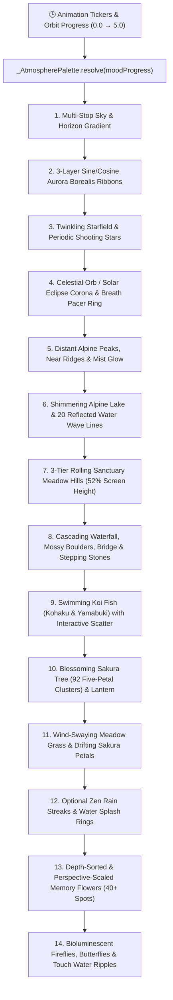

<div align="center">

# 🪷 BLOOM

### *A 100% Procedural Living Sanctuary & Mindful Gratitude Journal in Flutter*

[](https://flutter.dev)
[](https://dart.dev)
[](#%EF%B8%8F-14-layer-procedural-rendering-pipeline)
[](#%EF%B8%8F-14-layer-procedural-rendering-pipeline)
[](#-%E6%A3%AE-6-celestial-orbit-atmospheres)
[](LICENSE)

<br />

> **Every good moment deserves to bloom.**  
> **Bloom** turns daily gratitude into a living, breathing, 60 FPS procedural sanctuary. Plant one good memory each day and watch your personal alpine lake, cascading waterfall, Koi pond, and 3-tier meadow come alive—rendered **entirely in real time with `CustomPainter` and mathematical shaders (zero raster image assets).**

---

[✨ Features](#-key-highlights) •
[🪐 6 Celestial Realms](#-6-celestial-orbit-atmospheres) •
[🌸 Botanical Species](#-6-procedural-botanical-flower-species) •
[🧘 Breath & Milestones](#-guided-breath-pacer--sanctuary-milestones) •
[🏗️ Architecture](#%EF%B8%8F-14-layer-procedural-rendering-pipeline) •
[🚀 Getting Started](#-getting-started)

</div>

---

## ✨ Key Highlights

- 🎨 **100% Pure Procedural `CustomPainter` Engine** — Every star, Aurora Borealis ribbon, solar eclipse corona, mountain ridge, shimmering lake reflection, cascading stream, swimming Koi fish, swaying grass blade, Sakura tree, and 3D planet orb is painted mathematically on the Flutter `Canvas`. **Zero PNG/JPG scene assets.**
- 🪐 **Interactive Celestial Orbit Dial (`ModeDial`)** — Drag a precision chronometer needle across a 360° planetary orbit to continuously interpolate sky, mountain, lake, and meadow palettes in real time across **6 atmospheric realms**.
- 🌸 **Real Memories Only (Zero Fake Flowers)** — Every flower in the meadow represents a real gratitude memory you planted. Flowers are placed across a **3-tier terraced sanctuary**, sorted back-to-front by vertical depth (`dy`), and scaled with 3D perspective (`0.72x` on the upper hillside to `1.02x` in the foreground).
- 🧘 **Visual Guided Breath Pacer** — Integrated celestial breathing rings (**Box Breathing `4-4-4-4`**, **Deep Calm `4-7-8`**, and **Gentle Flow `4-4`**) radiate around the sun, moon, or solar eclipse with synchronized tactile haptics.
- 🎵 **Multi-Layer Studio Audio Engine** — Combines 6 studio-mastered ambient soundscapes with an independent **Zen Rain** acoustic layer and reactive sound effects (`bloom.wav`, `chime_gust.wav`, `ripple.wav`, `tap.wav`).
- 📸 **Botanical Specimen Postcards** — Tap any blooming flower in your garden to revisit the memory, edit today's entry, or generate a vintage **Botanical Specimen Postcard** ready to copy and share.

---

## 🪐 6 Celestial Orbit Atmospheres

Drag the **Celestial Orbit Dial** to smoothly morph the entire world between six distinct atmospheric realms:

<table>
  <thead>
    <tr>
      <th align="left">Realm</th>
      <th align="left">Subtitle</th>
      <th align="center">Primary Accent</th>
      <th align="center">Sky → Horizon Palette</th>
      <th align="center">Aurora / Stars</th>
      <th align="left">Studio Soundtrack & Visual Signature</th>
    </tr>
  </thead>
  <tbody>
    <tr>
      <td>🌅 <b>Dusk</b></td>
      <td><i>Ember Horizon</i></td>
      <td align="center"></td>
      <td align="center"><code>#140D1E</code> → <code>#D9603B</code></td>
      <td align="center"><code>0%</code> / <code>25%</code></td>
      <td>🎵 <code>dusk.mp3</code> — Warm amber sunset glow over violet-plum peaks</td>
    </tr>
    <tr>
      <td>🌌 <b>Midnight</b></td>
      <td><i>Starlit Abyss</i></td>
      <td align="center"></td>
      <td align="center"><code>#030714</code> → <code>#1F3666</code></td>
      <td align="center"><code>30%</code> / <code>90%</code></td>
      <td>🎵 <code>Midnight.mp3</code> — Deep indigo cosmos, twinkling starfield & shooting stars</td>
    </tr>
    <tr>
      <td>🌑 <b>Eclipse</b></td>
      <td><i>Obsidian Corona</i></td>
      <td align="center"></td>
      <td align="center"><code>#05030A</code> → <code>#3B1E54</code></td>
      <td align="center"><code>20%</code> / <code>95%</code></td>
      <td>🎵 <code>Eclipse.mp3</code> — Total solar eclipse obsidian core with violet-white corona</td>
    </tr>
    <tr>
      <td>🌿 <b>Emerald</b></td>
      <td><i>Bioluminescent</i></td>
      <td align="center"></td>
      <td align="center"><code>#04120E</code> → <code>#1E5C47</code></td>
      <td align="center"><code>85%</code> / <code>65%</code></td>
      <td>🎵 <code>Emerald.mp3</code> — Lush jade sanctuary with glowing mint fireflies & aurora</td>
    </tr>
    <tr>
      <td>✨ <b>Aurora</b></td>
      <td><i>Polar Shimmer</i></td>
      <td align="center"></td>
      <td align="center"><code>#030E14</code> → <code>#15525C</code></td>
      <td align="center"><code>100%</code> / <code>80%</code></td>
      <td>🎵 <code>Aurora.mp3</code> — 3-wave cyan/violet Aurora Borealis curtains dancing overhead</td>
    </tr>
    <tr>
      <td>☀️ <b>Dawn</b></td>
      <td><i>Golden Awakening</i></td>
      <td align="center"></td>
      <td align="center"><code>#1C3554</code> → <code>#FFB870</code></td>
      <td align="center"><code>0%</code> / <code>12%</code></td>
      <td>🎵 <code>Dawn.mp3</code> — Morning gold sun, fluttering butterflies & sunlit emerald hills</td>
    </tr>
  </tbody>
</table>

---

## 🌸 6 Procedural Botanical Flower Species

When planting a memory, choose from **6 custom-rendered botanical species**, each drawn with curved stems, veined leaves, swaying physics, and intricate multi-layered petals:

<table>
  <thead>
    <tr>
      <th align="center">Icon</th>
      <th align="left">Species Name</th>
      <th align="center">Primary Color</th>
      <th align="left">Procedural Canvas Geometry</th>
      <th align="left">Gratitude Symbolism</th>
    </tr>
  </thead>
  <tbody>
    <tr>
      <td align="center">🌸</td>
      <td><b>Sakura Blossom</b></td>
      <td align="center"></td>
      <td>5 notched heart-shaped petals, crimson core & 8 golden-tipped stamens</td>
      <td>Delicate cherry blossom carrying gentle joy</td>
    </tr>
    <tr>
      <td align="center">🌻</td>
      <td><b>Sunburst Sunflower</b></td>
      <td align="center"></td>
      <td>Dual 12-petal golden rings & Fibonacci-seeded brown disc center</td>
      <td>Warm and radiant, soaking up bright moments</td>
    </tr>
    <tr>
      <td align="center">🌹</td>
      <td><b>Velvet Rose</b></td>
      <td align="center"></td>
      <td>3 concentric spiral tiers of crimson, ruby & blush-pink petals</td>
      <td>Deep gratitude and heartfelt appreciation</td>
    </tr>
    <tr>
      <td align="center">🌼</td>
      <td><b>Wild Chamomile</b></td>
      <td align="center"></td>
      <td>10 slender cream-white ray florets around a domed amber-gold button</td>
      <td>Crisp white petals of calm and inner peace</td>
    </tr>
    <tr>
      <td align="center">💜</td>
      <td><b>Royal Lavender</b></td>
      <td align="center"></td>
      <td>6-tier vertical botanical spike with triplets of violet-lilac buds</td>
      <td>Soothing serenity and quiet reflection</td>
    </tr>
    <tr>
      <td align="center">🪷</td>
      <td><b>Sacred Lotus</b></td>
      <td align="center"></td>
      <td>7 pointed gradient petals fanning upward with a glowing golden heart</td>
      <td>Pure blooming wisdom rising from stillness</td>
    </tr>
  </tbody>
</table>

---

## 🧘 Guided Breath Pacer & Sanctuary Milestones

### 🌬️ Visual Breath Pacer Rhythms
Long-press or tap the **Breath Pacer** icon in the floating sensory capsule to activate a celestial breathing guide around the Sun/Moon/Eclipse:

<table>
  <thead>
    <tr>
      <th align="left">Breathing Mode</th>
      <th align="center">Inhale</th>
      <th align="center">Hold In</th>
      <th align="center">Exhale</th>
      <th align="center">Hold Out</th>
      <th align="left">Mindful Benefit</th>
    </tr>
  </thead>
  <tbody>
    <tr>
      <td>🟩 <b>Box Breathing</b></td>
      <td align="center"><code>4s</code></td>
      <td align="center"><code>4s</code></td>
      <td align="center"><code>4s</code></td>
      <td align="center"><code>4s</code></td>
      <td>Balances autonomic rhythm & sharpens calm focus</td>
    </tr>
    <tr>
      <td>🟦 <b>Deep Calm (4-7-8)</b></td>
      <td align="center"><code>4s</code></td>
      <td align="center"><code>7s</code></td>
      <td align="center"><code>8s</code></td>
      <td align="center"><code>0s</code></td>
      <td>Parasympathetic nervous system release & sleep prep</td>
    </tr>
    <tr>
      <td>🟨 <b>Gentle Flow</b></td>
      <td align="center"><code>4s</code></td>
      <td align="center"><code>0s</code></td>
      <td align="center"><code>4s</code></td>
      <td align="center"><code>0s</code></td>
      <td>Effortless heart-rate variability (HRV) coherence</td>
    </tr>
  </tbody>
</table>

### 🏆 Architectural Sanctuary Milestones
As your gratitude journal grows, your garden permanently unlocks new architectural landmarks painted directly into the landscape:

<table>
  <thead>
    <tr>
      <th align="center">Milestone</th>
      <th align="left">Unlocked Landmark</th>
      <th align="left">Visual Description</th>
    </tr>
  </thead>
  <tbody>
    <tr>
      <td align="center"></td>
      <td>🪨 <b>Mossy Stepping Stones</b></td>
      <td>A path of river stones with emerald moss appears across the cascading stream</td>
    </tr>
    <tr>
      <td align="center"></td>
      <td>🏮 <b>Hanging Sakura Lantern</b></td>
      <td>A warm wooden lantern hangs from the Sakura bough, casting a soft radial aura</td>
    </tr>
    <tr>
      <td align="center"></td>
      <td>🌉 <b>Arched Timber Footbridge</b></td>
      <td>A handcrafted wooden arch bridge with posts and handrails spans the upper waterfall</td>
    </tr>
  </tbody>
</table>

---

## 🏗️ 14-Layer Procedural Rendering Pipeline

All visuals are rendered at 60 FPS inside [`MasterpieceGardenPainter`](lib/main.dart) and [`ProceduralPlanetSphere`](lib/mode_dial.dart):



---

## 🎮 Interactive Touch & Sensory Guide

<table>
  <thead>
    <tr>
      <th align="left">Interaction Target</th>
      <th align="left">Gesture</th>
      <th align="left">Visual, Audio & Haptic Response</th>
    </tr>
  </thead>
  <tbody>
    <tr>
      <td>🌳 <b>Sakura Tree Canopy</b></td>
      <td>Tap</td>
      <td>Triggers a wind gust sway, 35 swirling blossom petals, <code>chime_gust.wav</code> & haptic pulse</td>
    </tr>
    <tr>
      <td>🌸 <b>Any Blooming Flower</b></td>
      <td>Tap</td>
      <td>Highlights the flower with a golden aura, plays <code>tap.wav</code> & opens the Memory Inspector sheet</td>
    </tr>
    <tr>
      <td>🐟 <b>Koi Pond</b></td>
      <td>Tap</td>
      <td>Expands concentric water ripples, plays <code>ripple.wav</code> & makes the Koi fish dart playfully</td>
    </tr>
    <tr>
      <td>🪐 <b>Bottom Orbit Pill</b></td>
      <td>Tap / Drag</td>
      <td>Opens the 360° Celestial Orbit Dial (`ModeDial`) with real-time continuous palette interpolation</td>
    </tr>
    <tr>
      <td>🧘 <b>Breath Pacer Icon</b></td>
      <td>Tap / Long-Press</td>
      <td>Toggles the celestial breathing ring (Tap) or opens the Rhythm Selector sheet (Long-Press)</td>
    </tr>
    <tr>
      <td>🌧️ <b>Water Drop Icon</b></td>
      <td>Tap</td>
      <td>Toggles the procedural rainfall overlay + <code>ambient_rain.wav</code> acoustic loop</td>
    </tr>
  </tbody>
</table>

---

## 📂 Project Structure

```text
Bloom/
├── android/
│   └── app/src/main/
│       ├── AndroidManifest.xml                  # App label ("Bloom") & adaptive icon config
│       └── res/
│           ├── drawable/
│           │   ├── ic_launcher_background.xml   # Vector emerald-midnight sanctuary backdrop
│           │   └── ic_launcher_foreground.xml   # Vector sacred lotus bloom, halo & ripples
│           └── mipmap-*/                        # Adaptive XMLs & supersampled launcher PNGs
├── assets/
│   └── audio/                                   # Studio MP3 soundscapes & procedural WAV SFX
│       ├── Aurora.mp3, Dawn.mp3, dusk.mp3
│       ├── Eclipse.mp3, Emerald.mp3, Midnight.mp3
│       └── ambient_rain.wav, bloom.wav, chime_gust.wav, ripple.wav, tap.wav
├── lib/
│   ├── main.dart                                # MasterpieceGardenPainter, sheets, audio & HUD
│   └── mode_dial.dart                           # 360° Celestial Orbit dial & ProceduralPlanetSphere
├── LICENSE                                      # MIT License
├── pubspec.yaml                                 # Flutter configuration & dependencies
└── README.md                                    # Documentation
```

---

## 🚀 Getting Started

### Prerequisites
- **Flutter SDK**: `>=3.4.0 <4.0.0`
- **Android Studio / VS Code** with Flutter & Dart plugins

### Installation & Run

```bash
# 1. Clone the repository
git clone https://github.com/Maher-Tec/Bloom.git
cd Bloom

# 2. Fetch Flutter dependencies
flutter pub get

# 3. Run on your connected device or emulator
flutter run
```

### Build Release APK

```bash
flutter build apk --release
```

---

## 🤝 Contributing

Contributions, issues, and feature requests are welcome!
1. Fork this repository
2. Create your feature branch (`git checkout -b feature/amazing-addition`)
3. Commit your changes (`git commit -m 'Add amazing addition'`)
4. Push to the branch (`git push origin feature/amazing-addition`)
5. Open a Pull Request

---

## 📄 License

Distributed under the **MIT License**. See [`LICENSE`](LICENSE) for full details.

<div align="center">
  <br />
  <b>Crafted with 💚 and pure Flutter <code>CustomPainter</code> math by <a href="https://github.com/Maher-Tec">Maher-Tec</a></b>
</div>
